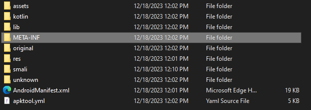

# Archive-Reader-Downgrade
A repository to save the older version of the Archive Reader app to avoid its sudden subscription model.

# Download
***[DOWNLOAD THE DOWNGRADED APK](https://mega.nz/file/0Ch3zKrY#Wp2CmymjpNrkZtg7FH_r5wZ5z8IN1u_rX9dZ6S9A0To)***
***[DOWNLOAD MIRROR 1 - MediaFire](https://www.mediafire.com/file/mokvnun8gudnzoa/Archive_Reader_1.5.2.apk/file)***
***[DOWNLOAD MIRROR 2 - Google Drive](https://drive.google.com/file/d/1KLrM7s4wqeVz-1Fd4Ce2umTdfptiytzu/view?usp=sharing)***

# Why
Because the dev of [Archive Reader](https://play.google.com/store/apps/details?id=com.readerapps.ao3_reader&hl=en_US&gl=US&pli=1) (link goes to the google play page) launched a surprise update that essentially forces a subscription model. While only 1$ a month, there are other ways to monetize and app and arguably this app did NOT need to be monetized unless it's backend is using way more than it should be.

This repository allows access to an older version of the app, version 1.5.2, that users can install to subvert this update.

Trying to also rip the source code and make that available in a different repo.

# How
- Download the APK
- Install the APK on your android device.
